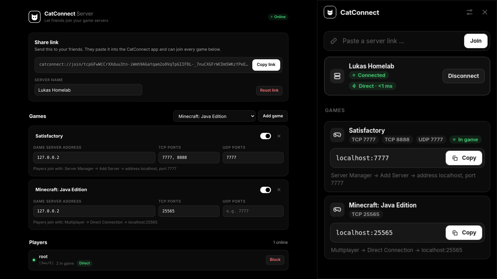

# CatConnect 🐈



**Let friends join the game servers in your homelab: no account, no port
forwarding, no VPN setup.** Pick a preset (Minecraft, Satisfactory, Valheim
…), share one link, and friends join through the CatConnect app.
End-to-end encrypted. Powered by [tailcat](https://github.com/tailscale/tailcat).

CatConnect has two parts:

| | Runs on | What it does |
|---|---|---|
| **CatConnect Server** | your homelab, NAS or any always-on machine (Docker or a single binary) | forwards the ports of the game servers you choose; configured in the browser |
| **CatConnect** (app) | your friends' computers (Windows, macOS, Linux) | sits in the tray; paste the link and the games appear on `localhost` |

## Download

Everything is on the **[Releases page](../../releases/latest)**:

| | File |
|---|---|
| App for players, Windows | `CatConnect-Setup-windows-x64.exe` (installer) or `CatConnect-portable-windows-x64.exe` |
| App for players, macOS | `CatConnect-macOS.zip` (Intel and Apple Silicon) |
| App for players, Linux | `CatConnect-linux-x64` (needs GTK 4 and WebKitGTK 6.0) |
| Server (homelab) | Docker image `ghcr.io/sniphs98/catconnect-server`, or `catconnect-server-linux-x64` / `-linux-arm64` / `-windows-x64.exe` / `-darwin-arm64` |

The apps aren't code-signed. On Windows, click *More info → Run anyway*. On
macOS, right-click the app and choose *Open* (on macOS 15 and later: *System
Settings → Privacy & Security → Open Anyway*).

## How it works

1. **Run the server** next to your game servers and open its admin page.
2. **Add your games.** Pick a preset, enter the game server's address (e.g.
   `192.168.1.30`, or `127.0.0.1` if it runs on the same machine), save.
3. **Copy the share link** (`catconnect://join/…`) and send it to your friends.
4. **Friends install the CatConnect app** and click or paste the link. The
   app shows each game with the address to use in-game, e.g.
   *Satisfactory → `localhost:7777`*, plus how to join.

The connection starts through a DERP relay (by default the free,
rate-limited tailcat relays) and then switches to a **direct peer-to-peer
connection** whenever NAT traversal succeeds, which is usually the case. The
app shows **⚡ Direct** or **Relay** and the ping. Everything goes through a
WireGuard tunnel; the relay only sees encrypted packets.

Ports are forwarded 1:1: TCP 7777 at your game server is TCP 7777 on your
friend's computer. This matters for games like Satisfactory, whose server
tells clients to come back on a second port (8888).

## Server setup

### Docker (recommended)

```yaml
# docker-compose.yml
services:
  catconnect:
    image: ghcr.io/sniphs98/catconnect-server:stable   # latest release; :latest follows main
    container_name: catconnect
    restart: unless-stopped
    network_mode: host          # best for direct connections and reaching your LAN
    volumes:
      - ./catconnect-data:/data
    environment:
      CATCONNECT_LISTEN: ":8080"
      # CATCONNECT_PASSWORD: "change-me"
```

```bash
docker compose up -d
```

```bash
docker compose logs catconnect
```

The log shows the share link and, on first start, the generated admin
password (also saved in `catconnect-data/admin-password`). Open
`http://<server>:8080` and log in with any user name and that password.

### Single binary

Download `catconnect-server` for your platform from the
[Releases page](../../releases/latest) (Linux x64/arm64, Windows, macOS) and
run it:

```bash
./catconnect-server-linux-x64 --data ./catconnect-data
```

| Flag | Environment | Default |
|---|---|---|
| `--data` | `CATCONNECT_DATA` | `/data` in Docker, else `./catconnect-data` |
| `--listen` | `CATCONNECT_LISTEN` | `:8080` (admin page) |
| `--password` | `CATCONNECT_PASSWORD` | generated on first start |
| | `CATCONNECT_DERPMAP_URL` | tailcat's relays |

### What the server stores

- `identity.json`: the server's keys and relay region. **This is what keeps
  your link the same across restarts and updates.** Back it up; anyone with
  it can impersonate your server.
- `config.json`: server name, games, blocked players.
- `admin-password`: the admin page password.

## Presets

| Game | Ports |
|---|---|
| Minecraft: Java Edition | TCP 25565 |
| Minecraft: Bedrock Edition | UDP 19132 |
| Satisfactory | TCP 7777, 8888 · UDP 7777 |
| Valheim | UDP 2456–2457 |
| Terraria | TCP 7777 |
| Factorio | UDP 34197 |
| Palworld | UDP 8211 |
| Project Zomboid | UDP 16261–16262 |
| Enshrouded | UDP 15636–15637 |
| 7 Days to Die | TCP 26900 · UDP 26900–26903 |
| Counter-Strike 2 / Source games | TCP + UDP 27015 |
| Rust | UDP 28015 |

Ports can be changed per game (if your Minecraft server runs on 25570, just
type that), and **Custom game…** takes any TCP/UDP ports. Presets
deliberately leave out admin ports such as RCON. New presets live in
[`internal/presets/presets.json`](internal/presets/presets.json); pull
requests welcome.

Two games can't use the same port at once (e.g. Satisfactory and Terraria
both use 7777); the admin page tells you when they clash.

## The player app

- **Join:** click a `catconnect://` link, or paste it into the app.
- **Play:** in the game, connect to the address shown, e.g. `localhost:25565`.
- **Saved servers:** servers you joined before stay in the list for one-click
  rejoining. With *Reconnect on start* (on by default) the app rejoins the
  last server when it starts.
- **Tray:** closing the window keeps the connection up; *Quit* in the tray
  menu or in Settings disconnects. *Start with my computer* is in Settings.
- **Your name:** shown to the server owner in the player list (Settings).

If a port is already in use on the player's computer (e.g. they run their own
Minecraft server), the app says so for that game.

## Limits

- **UDP packets over 1232 bytes** don't fit through the tunnel and are
  dropped. Most games stay below that, including Unreal Engine games like
  Satisfactory. Both the admin page and the app show a warning if it happens.
- **LAN discovery doesn't work.** Games that only find servers by
  broadcasting on the local network won't list them; use direct connect with
  the address shown. Games that only join through Steam lobbies can't use
  CatConnect.
- **Relayed connections are slow.** If a direct connection isn't possible,
  traffic goes through the shared, rate-limited tailcat relays, which isn't
  great for gaming. You can run your own
  [DERP relay](https://github.com/tailscale/tailscale/tree/main/cmd/derper#derp)
  (needs a publicly reachable host) and point `CATCONNECT_DERPMAP_URL` at it.

## Security

- **The link is the key.** Anyone with the link can reach the games you
  share, but nothing else: only the configured ports are forwarded, not your
  network. Share it privately.
- **Block players** on the admin page: each app has its own key, so a
  blocked player stays blocked.
- **Reset link** creates a new link; the old one stops working for everyone.
- The admin page uses HTTP basic auth over plain HTTP. Keep it on your LAN
  (or behind a reverse proxy with TLS) and don't expose port 8080 to the
  internet.

tailcat describes itself as experimental; see its
[SECURITY.md](https://github.com/tailscale/tailcat/blob/main/SECURITY.md).

## Releasing

On GitHub: **Actions → build → Run workflow**, enter a version such as
`v0.2.0` and run it. GitHub Actions builds everything, publishes the release
with all downloads and tags the Docker image as `:v0.2.0` and `:stable`.
Pushing a `v*` tag, or publishing a release with a new tag on the Releases
page, does the same.

## Development

You need Go 1.27.2 or newer. For the app you also need Node.js 22,
[Wails v3](https://v3.wails.io) and on Linux GTK 4 and WebKitGTK 6.0:

```bash
go install github.com/wailsapp/wails/v3/cmd/wails3@v3.1.0
```

```bash
sudo apt install libgtk-4-dev libwebkitgtk-6.0-dev
```

Tests (tunnel forwarding of TCP and UDP, config updates, blocking, stable
links, reconnecting after a server restart), using a local relay with no
internet access needed:

```bash
go test ./internal/...
```

Run the server:

```bash
go run ./cmd/catconnect-server
```

Build the app (output in `client/bin/`):

```bash
cd client && wails3 build
```

Package the Windows app and installer (works from Linux with `nsis`):

```bash
cd client && wails3 task windows:package ARCH=amd64 INSTALL_SCOPE=user
```

### Project layout

| Path | Contents |
|------|----------|
| `cmd/catconnect-server/` | Server: identity and config storage, admin page and API |
| `client/` | Player app (Wails v3, tray, vanilla JS UI) |
| `internal/host/` | Server side of the tunnel: forwards ports to game servers |
| `internal/guest/` | App side: opens the ports on `localhost` and forwards them |
| `internal/proto/` | Share links and the control protocol |
| `internal/presets/` | Game presets |

The app talks to the server over a control connection inside the tunnel
(TCP 61000): it sends a hello with the player's name, and the server answers
with the list of games, again whenever it changes and every 10 seconds as a
keepalive.

## Credits

- [tailcat](https://github.com/tailscale/tailcat) and
  [Tailscale](https://github.com/tailscale/tailscale) (BSD-3-Clause) for the
  networking
- [Wails v3](https://v3.wails.io) for the app shell and tray
- Sister project: [CatJump](https://github.com/Sniphs98/TailcatFileShare) for
  sharing files

CatConnect is an independent project and is not affiliated with or endorsed
by Tailscale Inc.
